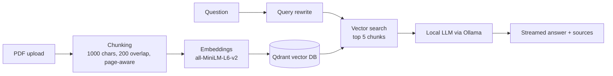

# Private PDF Chatbot
<video src="RAG Project Demo.mp4" controls width="100%"></video>

A fully local RAG (Retrieval-Augmented Generation) application. Upload a PDF, ask questions in plain English, and get answers that cite the exact pages they came from. Embeddings, vector search and the language model all run on your own machine, so your documents never leave it.


## Why I built it

Most "chat with your PDF" demos send your document to a cloud API. I wanted to see how far a private, offline version could go on ordinary laptop hardware, and to treat it like a real engineering project: measure it, find its bottlenecks, and make it reproducible with a single command.

## Features

- **Cited answers:** every answer shows the chunks it was built from, with page number and similarity score
- **Streaming responses:** words appear as the local model writes them
- **Query rewriting:** vague questions such as "what is this about" are rewritten into better search queries using a hint from the document
- **Chunk inspector:** browse and filter every stored chunk to see exactly what the system knows
- **Evaluation harness:** a local script and a System Metrics tab covering retrieval hit rate, answer keyword score, faithfulness, refusal accuracy and latency
- **Export:** download a Q&A session as Markdown or JSON
- **Dark developer-console UI** with a zoom control (75% to 150%)
- **REST API** built with FastAPI, including a health endpoint that checks every dependency

## How it works



1. **Ingest:** the PDF is split page by page into overlapping chunks that end on sentence boundaries, so every chunk has a trustworthy page number.
2. **Embed and store:** each chunk becomes a 384-number vector and is stored in Qdrant together with its text, page and file name.
3. **Rewrite:** a lightweight step turns the user's question into a short search query, using the document's name and opening text as context.
4. **Retrieve:** the original question and the rewritten query are both searched, and each chunk keeps its best score. The top 5 chunks are returned.
5. **Generate:** the chunks are given to a local model with instructions to answer only from the numbered sources, cite them, and say so when the answer is not in the document.

## Tech stack

| Layer | Technology |
|---|---|
| Backend API | FastAPI, Uvicorn |
| Frontend | Streamlit with custom CSS |
| Vector database | Qdrant |
| Embeddings | sentence-transformers (all-MiniLM-L6-v2) |
| Language model | Ollama (gemma3:1b by default) |
| PDF parsing | pypdf |
| Packaging | Docker Compose |

## Quick start

**Prerequisites:** [Docker Desktop](https://www.docker.com/products/docker-desktop) and [Ollama](https://ollama.com/download), both installed and running.

```bash
# 1. Download a model
ollama pull gemma3:1b

# 2. Configure (optional)
cp .env.example .env        # Windows: copy .env.example .env

# 3. Start everything
docker-compose up --build
```

Open **http://localhost:8501**, upload a PDF, click **Process PDF**, and start asking questions. The API's interactive documentation is at **http://localhost:8000/docs**.

The API runs in Docker while Ollama runs directly on the host. On Windows, set the environment variable `OLLAMA_HOST=0.0.0.0`, restart Ollama, and allow it through the firewall so the containers can reach it.

## Configuration

Set these in a `.env` file next to `docker-compose.yml`:

| Variable | Default | Meaning |
|---|---|---|
| `OLLAMA_MODEL` | `llama3.2:3b` | Which local model answers questions |
| `USE_REWRITE` | `true` | Rewrite the question before searching |
| `MAX_ANSWER_TOKENS` | `500` | Maximum answer length |
| `NUM_CTX` | `4096` | How much text the model can read at once |

## API

| Endpoint | Purpose |
|---|---|
| `GET /health` | Is the API alive |
| `GET /health/full` | Checks the API, Qdrant, Ollama, and whether the configured model is installed |
| `POST /upload` | Upload and index a PDF |
| `POST /ask` | Ask a question, get the full answer with sources |
| `POST /ask_stream` | Same, streamed as newline-delimited JSON events (`meta`, `token`, `done`, `error`) |
| `GET /chunks` | List stored chunks (up to 500) |
| `GET /metrics` | Evaluation history |

## Evaluation

Questions with known answers live in `eval/qa_pairs.json`. The script asks the app each question and measures:

- **Retrieval hit rate:** did the retrieved chunks contain the facts needed to answer?
- **Answer keyword score:** how many of the expected key terms appear in the answer?
- **Faithfulness:** a judge model checks whether every claim in the answer is supported by the retrieved sources. The judge is the same small local model, so this is an indicator rather than proof.
- **Refusal accuracy:** for questions that are not in the document, does the app correctly say it could not find the answer?
- **Average latency** per question

```bash
docker-compose exec api python evaluate.py          # full run, including the faithfulness judge
docker-compose exec api python evaluate.py --fast   # skip the judge
```

Every run is appended to `eval/results.json`. The **System Metrics** tab shows the latest run and a history of all runs, so different models and settings (for example query rewriting on versus off) can be compared side by side.


## Engineering notes

**Vague questions broke query rewriting.** My first rewriter only saw the user's question. For "what is this about" it produced a search query unrelated to the document and a similarity score of about 15%. I fixed it in two ways: the rewriter now receives the document's file name and opening text, and retrieval searches with both the original question and the rewrite, keeping each chunk's best score, so a poor rewrite can no longer make retrieval worse.

**Slow local inference: measure first, then fix.** Early answers took up to about three minutes. `ollama run --verbose` showed roughly 3 tokens per second, and `ollama ps` showed the 3B model split 66% CPU / 34% GPU, because only about 1.3 GB of the card's 2 GB of video memory was free. I benchmarked three models (below) and chose the one that fits best. I then added streaming so the first words appear quickly, a cap on answer length, and a model keep-alive so the model is not reloaded between questions.

**Containers talking to the host.** The API runs in Docker but Ollama runs natively. Services reach each other by name (`qdrant:6333`, `api:8000`) and reach the host through `host.docker.internal`, which also required Ollama to listen on all interfaces.

**One codebase for different machines.** Every tunable (model, context size, answer length, rewriting on or off) is an environment variable with a safe default, read from `.env`. Laptops with different hardware run identical code and differ only in configuration.

**Failing loudly and visibly.** `/health/full` reports whether each dependency is reachable and whether the configured model is installed. The AI client has a timeout so a stuck model produces an error instead of an endless spinner, the streaming endpoint emits an explicit error event, and the UI distinguishes "API unreachable" from "server error".

**Evaluating instead of eyeballing.** Retrieval, answer quality, refusal behaviour and latency are measured against questions with known answers, so changes like the rewriter fix can be checked rather than assumed.

## Local performance benchmark

Measured on a laptop with 12 GB RAM and an NVIDIA GeForce 940MX (2 GB VRAM), using `ollama run <model> --verbose`:

| Model | Generation speed | Placement |
|---|---|---|
| llama3.2:3b | 2.98 tokens/s | 66% CPU / 34% GPU |
| llama3.2:1b | 4.60 tokens/s | 50% CPU / 50% GPU |
| gemma3:1b | 8.13 tokens/s | 24% CPU / 76% GPU |

The smaller the model, the more of it fits in 2 GB of video memory, and the faster it runs. I chose `gemma3:1b` as the default for the best speed on this hardware.

## Project structure

```
api.py                 FastAPI backend (upload, ask, stream, chunks, metrics, health)
ui.py                  Streamlit interface
rag_core.py            Retrieval, query rewriting, prompting, streaming
indexer.py             Chunks a PDF and stores it in Qdrant
pdf_utils.py           PDF reading and page-aware chunking
evaluate.py            Evaluation script
rag_chat.py            Minimal terminal chat
eval/                  Evaluation questions (and results)
docs/                  Screenshots
.streamlit/            Theme configuration
docker-compose.yml     Qdrant + API + UI
Dockerfile
requirements.txt
.env.example           Configuration template
```

## Limitations

These are known trade-offs of the current version, and most are on the roadmap below.

- **One document at a time.** Uploading a new PDF replaces the previous one.
- **Text-based PDFs only.** There is no OCR, so scanned pages and text embedded in images, diagrams or equations are not read.
- **Five chunks per question.** Specific questions work well, but broad requests such as "summarize the whole document" only see a slice of it.
- **No conversation memory.** Each question is answered independently, so follow-ups like "and what about the second one?" do not carry context.
- **Small local models have limits.** A 1B model can give shallower explanations than a large hosted model and does not always follow instructions exactly, for example by rewording the "not in the document" reply. Speed depends heavily on available video memory and CPU.
- **Single user, no authentication.** All sessions share the same stored document.
- **Evaluation is approximate.** Retrieval and keyword checks are simple string matches, the question set is small, and the faithfulness judge is the same small model it is judging.
- **The zoom control uses the CSS `zoom` property**, which works best in Chromium-based browsers.

## What I learned

- **RAG quality is mostly decided before the language model runs.** Chunk size, overlap, sentence boundaries and the search query had a bigger effect on answer quality than any prompt wording.
- **A prompt can change style, not facts.** My system prompt gets structured explanations, inline citations and honest "not in the document" replies, but it cannot rescue bad retrieval. Fixing retrieval was what made vague questions work.
- **Similarity scores are rankings, not probabilities.** A short question compared with a long paragraph often scores only 20 to 50% even when the chunk is exactly right, so I show the score as a relative signal next to the source text.
- **Hardware sets the design.** With 2 GB of video memory, model size decided whether inference ran on the GPU at all. Measuring with `ollama ps` and `--verbose` turned "it feels slow" into a decision backed by numbers.
- **Streaming does not make a model faster, but it makes a slow one usable.** Showing words as they are generated changes how the wait feels.
- **Production habits matter even in a small project:** health checks, timeouts, configuration through environment variables, error messages that name the real problem, and reading a traceback from the bottom up.
- **Docker networking:** containers find each other by service name, reach the host through `host.docker.internal`, and code changes need a rebuild because the code is baked into the image.

## Roadmap

- Multiple documents with per-document filtering
- OCR for scanned PDFs
- Chat memory for follow-up questions
- Re-ranking of retrieved chunks
- Evaluation with Ragas and a stronger judge model

## Author

Syeda Tooba Samreen,toobasyeda18-oss, www.linkedin.com/in/syeda-tooba-0769b6372.
